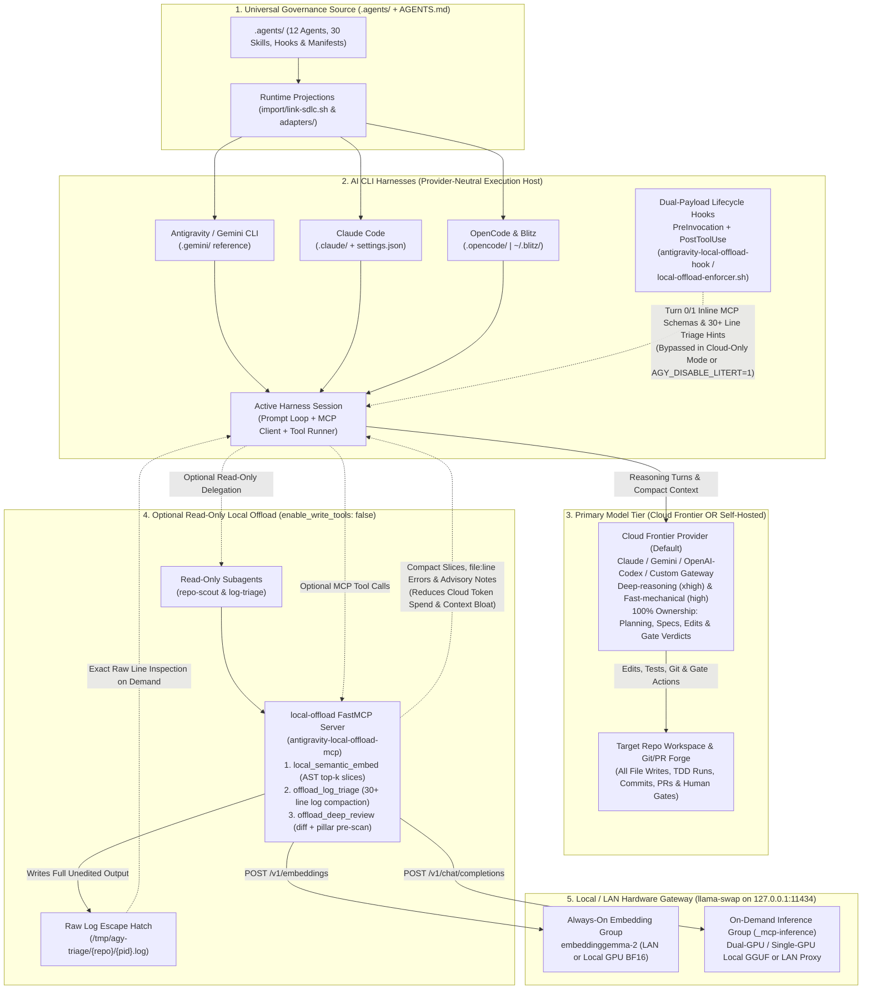

# CADENCE — Provider-Neutral Agentic SDLC Governance & Optional Local Coprocessor Offload

**CADENCE** (*Contextual Architecture, Decomposition, Execution, Navigation, Consolidation & Enshrinement*) is a **provider-neutral, CLI-neutral agentic software development lifecycle (SDLC) framework** built to run primarily on **cloud frontier providers** (Anthropic Claude, Google Gemini, OpenAI/Codex-compatible endpoints, or enterprise gateways configured in your AI CLI harness and bound in [`processes/docs/agentic-sdlc/CADENCE_ORG_TEMPLATE.md#model-tier-mapping`](processes/docs/agentic-sdlc/CADENCE_ORG_TEMPLATE.md#model-tier-mapping)) **or** self-hosted/local models.

Alongside those primary reasoning and coding agents (`Deep-reasoning` at `xhigh` effort and `Fast-mechanical` at `high` effort), CADENCE ships an **optional, strictly read-only local hardware coprocessor offload stack** (`llama-swap`, `llama.cpp` (`llama-server`), LiteRT-LM, and the `local-offload` FastMCP server on `127.0.0.1:11434`) that pairs directly with cloud frontier agents to reduce cloud token spend, latency, and context bloat while the primary cloud model retains 100% ownership of planning, code edits, and human-gate verdicts.

**Version 2026.47.0** | [Release Notes](docs/releases/cadence-v1.1.0.md) | [Changelog](CHANGELOG.md)

---

## 1. Deployment Modes: Cloud Frontier, Hybrid Cloud + Local Offload, or Local-Only

CADENCE is **not local-AI-only**. Choose the execution topology that matches your team's hardware and provider setup:

| Mode | Primary Agents (`Deep-reasoning` & `Fast-mechanical`) | Local Offload (`:11434`) | Best For | Setup Path |
| :--- | :--- | :--- | :--- | :--- |
| **Cloud-Only** *(No Local GPU Required)* | Cloud frontier provider via your CLI harness (`Claude`, `Gemini`, `OpenAI/Codex`, or enterprise gateway) | Omitted or bypassed (`AGY_DISABLE_LITERT=1`) | Laptops without a dedicated GPU, CI/cloud sandboxes, rapid adoption | Skip Steps 1–3 and start at **Step 4** |
| **Hybrid Cloud + Local Offload** *(Recommended on GPU Hosts)* | Cloud frontier provider retains 100% write, planning, TDD, and human-gate ownership | Strictly read-only MCP + coprocessor subagents on local/LAN GPU | Cutting cloud token spend and keeping noisy repo scans and build logs out of cloud context | Run **Steps 1–4** |
| **Local / Self-Hosted Only** | Self-hosted or local OpenAI-compatible models bound in `CADENCE_ORG.md#model-tier-mapping` | Shares local/LAN `llama-swap` gateway or dedicated endpoints | Air-gapped, on-prem, or privacy-isolated environments | Run **Steps 1–4** with local endpoints |

**Strict Read-Only Coprocessor Boundary:** Even in Hybrid mode, `local-offload` MCP tools and coprocessor subagents run with `enable_write_tools: false` and never modify repository files, execute git mutations, or issue gate approvals. All file writes, TDD runs, commits, PR actions, and gate evaluations stay 100% owned by your primary model tier.

---

## 2. The 7 Phases of CADENCE

Every letter of **CADENCE** maps directly to a governed phase of the software engineering lifecycle:

1. **C — Classify**: Issue intake, 4-part problem framing (`VERB`, `SCOPE`, `WHY`, `CONSTRAINTS`), objective change-tier sizing (`Trivial`, `Low`, `Medium`, `High`), optional local semantic duplicate/codebase discovery, and intent elicitation (`cadence-triage-agent`, `/cadence-propose`, `/cadence-triage`, `/cadence-elicit`, `/cadence-mint`, `/cadence-define`).
2. **A — Architect & Explore**: Cross-boundary implicit contract discovery and 2–3 structurally distinct, unranked steelmanned design options (`cadence-architect`, `cadence-explorer`, `/cadence-define`).
3. **D — Decompose & Specify**: Grounding via the **Contextual Grounding Matrix (`6W×4L`)**, evaluation against **Engineering Pillars**, and **CHORD** 5-part behavioral decomposition (**C**onditions [`Given`], **H**andling/Triggers [`When`], **O**utcomes [`Then` external], **R**ules [`Then` invariants], **D**eltas [`Then` internal mutations]) into `spec.md` and Gherkin `test-plan.md`, gated by `[Human Gate: Spec Approval]` (`cadence-spec-author`, `/cadence-spec`, `/cadence-onboard`, `/cadence-interview`, `/cadence-doctor`).
4. **E — Execute via TDD**: Strict BDD Red $\rightarrow$ Green $\rightarrow$ Accumulate $\rightarrow$ Commit cycles, wide mechanical refactors, and expand/contract schema migrations (`cadence-implementer`, `cadence-migration-author`, `/cadence-implement`, `/cadence-refactor`, `/cadence-migrate`, `/cadence-build`, `/cadence-parallel`).
5. **N — Navigate Gates**: Optional local coprocessor pre-scans followed by `[Human Gate: Code Review]` and `[Human Gate: Maintainer Acceptance]` (`cadence-reviewer`, `cadence-security-auditor`, `cadence-maintainer`, `/cadence-review`, `/cadence-maintain`, `/cadence-watch`).
6. **C — Consolidate**: Tier-gated integration merges, same-session tracker projection to YouTrack or Jira, and clean deliverable ejects (`/cadence-close`, `/cadence-merge`, `/cadence-watch`, `/cadence-sync-youtrack`, `/cadence-sync-jira`, `/cadence-eject`).
7. **E — Enshrine**: Relocation to `archive/{ticket-id}/`, two-pass dead-citation sweeps, ADR and intent-insight promotion, cross-ticket retrospectives, living business flow updates (`docs/flows/`), and release cutting (`cadence-archivist`, `/cadence-archive`, `/cadence-retro`, `/cadence-release`, `/cadence-housekeep`).

---

## 3. Architecture: AI Harnesses, Cloud Providers & Optional Local Offload (`:11434`)



### Universal `.agents/` Primary Layout
Per [`processes/docs/policies/cli-runtime-adoption-policy.md`](processes/docs/policies/cli-runtime-adoption-policy.md):
- **`.agents/`** is the CLI-neutral primary source of truth (`.agents/agents/`, `.agents/skills/`, `.agents/hooks/`, `.agents/agents.json`, `.agents/skills.json`, and `AGENTS.md`).
- **`.gemini/`** is the canonical reference implementation for Google Antigravity (`agy`) and Gemini CLI, projected directly off `.agents/`.
- **`.claude/`**, **`.opencode/`**, and **`.blitz/`** project their runtime directories off `.agents/` via `import/link-sdlc.sh`, while dual-payload hooks in `.agents/hooks/` and MCP adapters in `processes/ci-templates/scripts/adapters/` wire the same optional `local-offload` MCP server across harnesses.

### How Cloud Providers & Optional Local Offload Work Together
Your configured **Cloud Frontier (or self-hosted) `Deep-reasoning` (`xhigh`) / `Fast-mechanical` (`high`) tier** drives every CADENCE turn and retains 100% ownership of planning, CHORD specifications, code authoring, and gate verdicts. When `local-offload` is enabled on `127.0.0.1:11434`, lifecycle hooks and MCP tools offload purely mechanical read/compact tasks off the cloud context window; omitting the `local-offload` MCP server or setting `AGY_DISABLE_LITERT=1` runs CADENCE 100% cloud-only with zero local GPU dependency:
1. **Turn 0/1 Inline Schema Injection (`antigravity-local-offload-hook`)**: Injects `[MANDATORY LITERT / LOCAL-OFFLOAD PIPELINE (:11434) — INLINE SCHEMAS READY]` on the first turn of every session (with cross-hook deduplication across `global-litert-offload-enforcer` and `cadence-local-offload-enforcer`, plus `AGY_DISABLE_LITERT=1` bypass for cloud-only runs or baseline benchmarks), allowing the primary agent to call `call_mcp_tool` immediately without reading `.json` schema files.
2. **Step 0 — Universal Discovery (`local_semantic_embed` / `repo-scout`)**: Boundary-aware AST/section chunking (`top_k=6` default, ~36-line Pinned Context Slices, File Symbol Maps `sym@L<line>`, truncation warnings past `max_files=80`, CamelCase symbol boost, and test-file demotion) on `:11434` (`embedding` / `embeddinggemma-2-BF16.gguf`) before broad file reads or repeated `grep`/`find` sweeps.
3. **Command, Build & Test Triage (`offload_log_triage` / `log-triage`)**: Deduplicated signal compaction for any command output `>30` lines or non-zero exit code via `inference`, while saving the full numbered raw output per repo and child PID to `/tmp/agy-triage/<repo_name>/<pid>.log` (symlinked at `/tmp/agy-triage/<repo_name>/latest.log` and mirrored to `/tmp/agy-last-triage.log`).
4. **Pre-Commit & Gate Deep Review (`offload_deep_review`)**: Diff-aware (`diff_range`) and deterministic mechanical pre-review against CADENCE Engineering Pillars (`<400`-line ceiling, `C1`–`C8` comment discipline, CHORD observability seams: `UNSOUND_CONDITION`, `RULE_DIVERGENCE`, `BOUNDARY_FAULT`, `DELTA_AUDIT_GAP`).

---

## 4. Repository Structure

```text
CADENCE/
├── AGENTS.md                        # Universal agent discovery manifest
├── README.md                        # End-to-end architecture & implementation guide
├── agents/                          # 12 governed subagents (10 CADENCE + repo-scout + log-triage)
│   ├── cadence-architect/
│   ├── cadence-archivist/
│   ├── cadence-explorer/
│   ├── cadence-implementer/
│   ├── cadence-maintainer/
│   ├── cadence-migration-author/
│   ├── cadence-reviewer/
│   ├── cadence-security-auditor/
│   ├── cadence-spec-author/
│   ├── cadence-triage-agent/
│   ├── log-triage/
│   └── repo-scout/
├── skills/                          # 30 governed /cadence-* workflow skills
│   ├── cadence-adopt/
│   ├── cadence-archive/
│   ├── cadence-build/
│   ├── cadence-bump-model/
│   ├── cadence-certainty/
│   ├── cadence-close/
│   ├── cadence-define/
│   ├── cadence-doctor/
│   ├── cadence-eject/
│   ├── cadence-elicit/
│   ├── cadence-housekeep/
│   ├── cadence-implement/
│   ├── cadence-interview/
│   ├── cadence-maintain/
│   ├── cadence-merge/
│   ├── cadence-migrate/
│   ├── cadence-mint/
│   ├── cadence-onboard/
│   ├── cadence-parallel/
│   ├── cadence-propose/
│   ├── cadence-refactor/
│   ├── cadence-release/
│   ├── cadence-retro/
│   ├── cadence-review/
│   ├── cadence-spec/
│   ├── cadence-sync-jira/
│   ├── cadence-sync-youtrack/
│   ├── cadence-triage/
│   ├── cadence-upgrade/
│   └── cadence-watch/
├── hooks/                           # Custom PreInvocation, PostToolUse & Stop lifecycle hooks
│   ├── antigravity-local-offload-hook
│   ├── local-offload-enforcer.sh
│   ├── tms-sync-reminder.sh
│   ├── tms-doc-sync-stop.sh
│   ├── hooks.json                   # Per-repository hook manifest
│   └── hooks.global.json            # Global ~/.gemini/config/hooks.json & ~/.agents/hooks.json
├── import/                          # Global & per-repo provisioning scripts and rule templates
│   ├── GEMINI.global.md             # Global rules installed to ~/.gemini/config/GEMINI.md
│   ├── agy-settings.example.json    # Antigravity CLI ~/.gemini/antigravity-cli/settings.json template
│   ├── agents.json                  # Universal agent directory index
│   ├── skills.json                  # Universal skill directory index
│   └── link-sdlc.sh                 # One-command global & per-repo installer
├── local-offload/                   # Complete LiteRT, FastMCP & llama-swap (:11434) stack
│   ├── README.md                    # Detailed llama-swap, GPU & MCP setup reference
│   ├── install-local-offload.sh     # Automated local-offload & systemd installer
│   ├── llama-swap/                  # llamaswap-server CLI, zsh plugin, and Dual/Single-GPU YAMLs
│   │   ├── llamaswap-server
│   │   ├── llamaswap-server.plugin.zsh
│   │   ├── local-ai-offload-serve
│   │   ├── llama-swap.egpu.yaml
│   │   └── llama-swap.single.yaml
│   ├── mcp/                         # FastMCP server, agy wrapper & lazy-loaded tool schemas
│   │   ├── agy
│   │   ├── antigravity-local-offload-mcp
│   │   ├── mcp_config.example.json
│   │   └── schemas/
│   │       ├── local_semantic_embed.json
│   │       ├── offload_log_triage.json
│   │       └── offload_deep_review.json
│   ├── litert-lm/
│   │   └── config.json              # ~/.litert-lm/config.json runtime configuration
│   ├── systemd/
│   │   └── local-ai-offload.service # Systemd user unit for llama-swap on :11434
│   └── scripts/
│       ├── build-llama.sh           # CUDA build script for llama.cpp (Blackwell / native)
│       ├── download-gemma.sh        # GGUF model download helper
│       ├── setup-egpu.sh            # Optional Linux USB4/TB5 eGPU PCIe & udev setup
│       ├── stress-test-litert.sh    # 4-suite LiteRT (:11434) + frontier A/B/C stress benchmark
│       └── nvidia-powerd-egpu-fix.c # LD_PRELOAD shim for nvidia-powerd with eGPU attached
├── processes/                       # Portable CADENCE templates, CI gate scripts, policies & docs
│   ├── artifacts/
│   ├── ci-templates/
│   ├── docs/
│   └── specs/
└── tests/                           # Offline CADENCE regression suite & 30-skill eval runner
    ├── eval_runner.py
    ├── run-cadence-tests.sh
    ├── run-evals.sh
    ├── test-certainty-gate.sh
    ├── test-pr-watch.sh
    ├── test-security-trigger.sh
    └── test-trace-gates.sh
```

---

## 5. Complete Implementation Guide (Step-by-Step)

> **Cloud-Only Fast Path:** Using CADENCE with a cloud provider only (no local GPU offload)? Skip Steps 1–3 and jump directly to **Step 4** below, then bind your cloud model IDs in `docs/agentic-sdlc/CADENCE_ORG.md#model-tier-mapping`.

### Step 1: Install Prerequisites (`uv`, `llama.cpp`, `llama-swap`, `zsh`) *(Optional — Local Offload Only)*

1. **Install `uv` (Python script runner used by the FastMCP server)**:
   ```bash
   curl -LsSf https://astral.sh/uv/install.sh | sh
   ```
2. **Build & install `llama.cpp` (`llama-server`) with CUDA**:
   ```bash
   git clone https://github.com/ggml-org/llama.cpp ~/projects/llama.cpp
   ./local-offload/scripts/build-llama.sh
   ```
3. **Install `llama-swap` (v256+) to `~/.local/bin/llama-swap`**:
   Download the latest Linux release binary from [mostlygeek/llama-swap releases](https://github.com/mostlygeek/llama-swap/releases) and place it at `~/.local/bin/llama-swap`:
   ```bash
   chmod +x ~/.local/bin/llama-swap
   ```

### Step 2: Download Required GGUF Models *(Optional — Local Offload Only)*

By default, `llamaswap-server` reads models from `~/.ollama/models/symlinks` (override with `-m /path/to/models` or `LLM_MODELS_DIR`). Create the directory and download the models:

```bash
mkdir -p ~/.ollama/models/symlinks
cd ~/.ollama/models/symlinks

# 1. Always-On GPU Embedding Model: Google EmbeddingGemma 2 BF16
curl -fL -O https://huggingface.co/ggml-org/embeddinggemma-300M-qat-q8_0-GGUF/resolve/main/embeddinggemma-2-BF16.gguf

# 2a. Dual-GPU Inference Models (28 GB combined VRAM: RTX 5080 16GB + RTX 5070 Ti 12GB):
#     Gemma 4 26B-A4B Coder Q5_K_M-imatrix (+ Vision mmproj)
curl -fL -O https://huggingface.co/unsloth/gemma-4-26B-A4B-it-GGUF/resolve/main/gemma-4-26B-A4B-it-mmproj-F16.gguf

# 2b. Single-GPU Fallback Inference Model (12 GB VRAM: Internal RTX 5070 Ti):
#     Gemma 4 12B IT (+ Vision mmproj)
curl -fL -o gemma4-12b.gguf https://huggingface.co/unsloth/gemma-4-12B-it-GGUF/resolve/main/gemma-4-12B-it-Q4_K_M.gguf
curl -fL -o gemma4-12b-mmproj.gguf https://huggingface.co/unsloth/gemma-4-12B-it-GGUF/resolve/main/gemma-4-12B-it-mmproj-F16.gguf
```

### Step 3: Install Local Offload & `llama-swap` Globally (CADENCE Stays Per-Repo) *(Optional — Local Offload Only)*

Clone this repository to `~/projects/sdlc` (or any directory) and run `link-sdlc.sh --global --enable-service`:

```bash
git clone git@github.com:AndrewK4758/CADENCE.git ~/projects/sdlc
cd ~/projects/sdlc
./import/link-sdlc.sh --global --enable-service
```

By default, `./import/link-sdlc.sh --global --enable-service` keeps CADENCE 100% repository-scoped and installs only the framework-neutral global stack (pass `--with-cadence-global` only on CADENCE-exclusive hosts):
- **`~/.agents/` & `~/.gemini/config/`**: Copies neutral coprocessor agents (`repo-scout`, `log-triage`), installs framework-neutral `hooks/hooks.global.json` (`global-local-offload-enforcer`), registers `local-offload` MCP in `~/.gemini/config/mcp_config.json`, and installs tool schemas into `~/.gemini/antigravity-cli/mcp/local-offload/*.json`.
- **`~/.blitz/`**: Links flat neutral coprocessor agents (`repo-scout.md`, `log-triage.md`) into `~/.blitz/agents/`.
- **`~/.local/bin/`**:
  - `antigravity-local-offload-mcp` (FastMCP server for `:11434` with AST-aligned Pinned Context Slices & `/tmp/agy-triage/<repo_name>/<pid>.log`)
  - `antigravity-local-offload-hook` (Global `PreInvocation` + `PostToolUse` lifecycle hook with Turn 0/1 inline schemas)
  - `agy` (Global launcher wrapper ensuring `~/.gemini/config/hooks.json` is always present)
  - `llamaswap-server` & `local-ai-offload-serve` (`llama-swap` wrapper with automatic GPU UUID detection)
- **`~/.config/llama-swap/`**:
  - `llamaswap-server.plugin.zsh`
  - `llama-swap.egpu.yaml` (Dual-GPU 5080 + 5070 Ti configuration)
  - `llama-swap.single.yaml` (Single-GPU 5070 Ti fallback configuration)
- **`~/.litert-lm/config.json`**: CPU thread and backend configuration for LiteRT-LM.
- **`~/.config/systemd/user/local-ai-offload.service`**: Enables and starts the persistent `llama-swap` service on `127.0.0.1:11434`.

*(Optional)* Source the ZSH plugin in `~/.zshrc` for interactive `llamaswap-server` tab completion:
```zsh
source ~/.config/llama-swap/llamaswap-server.plugin.zsh
```

### Step 4: Provision CADENCE into Any Project Repository

To link CADENCE into an individual project repository (creating `.agents/`, `.gemini/`, and optional `.claude/`, `.opencode/`, or `.blitz/` projections):

```bash
~/projects/sdlc/import/link-sdlc.sh /path/to/your/repo --claude --opencode --blitz
```

Or run the portable adoption script to copy the governance templates (`CADENCE_ORG.md`, `PROJECT_INTENT.md`, `specs/`, `docs/`) into a target repo:
```bash
bash ~/projects/sdlc/skills/cadence-adopt/adopt-cadence.sh /path/to/your/repo
```

In your target repository's `docs/agentic-sdlc/CADENCE_ORG.md`, bind your chosen cloud frontier (or self-hosted/local) provider identifiers under `## Model Tier Mapping` and declare your active harness under `## Runtime Binding`.

---

## 6. Verification & Health Checks

### Core CADENCE Verification (All Modes — Cloud-Only, Hybrid, or Local)

```bash
# Run the offline regression suite, 30-skill eval runner, and adoption doctor
bash tests/run-cadence-tests.sh
bash tests/run-evals.sh --verbose        # Add --with-offload for optional :11434 rubric grading
bash skills/cadence-doctor/doctor.sh --root .
```

### Optional Local Offload Verification (`:11434`, Hybrid / Local-Offload Hosts Only)

Once `local-ai-offload.service` is running, verify the `:11434` gateway:

```bash
# 1. Check systemd user service status
systemctl --user status local-ai-offload.service

# 2. Check loaded models in llama-swap (:11434)
curl -s http://127.0.0.1:11434/running | jq .

# 3. Verify 768-d semantic embeddings (embeddinggemma-2)
curl -s http://127.0.0.1:11434/v1/embeddings \
  -H 'Content-Type: application/json' \
  -d '{"model":"embedding","input":"search_query: CADENCE SDLC"}' | jq '.data[0].embedding | length'

# 4. Verify warm local inference
curl -s http://127.0.0.1:11434/v1/chat/completions \
  -H 'Content-Type: application/json' \
  -d '{"model":"inference","messages":[{"role":"user","content":"Reply with OK"}],"max_tokens":8}' | jq -r '.choices[0].message.content'
```

See [`local-offload/README.md`](local-offload/README.md) for deep-dive details on `llamaswap-server` flags, GPU UUID detection, eGPU power/PCIe scripts, custom hook internals, and troubleshooting.
