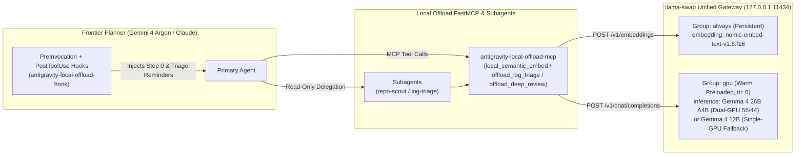

# CADENCE — Agentic SDLC Governance & Local Hardware Coprocessor Offload Stack

**CADENCE** (*Contextual Architecture, Decomposition, Execution, Navigation, Consolidation & Enshrinement*) is a CLI-neutral, hardware-tiered agentic software development lifecycle (SDLC) framework paired with a complete local AI coprocessor stack powered by **`llama-swap`**, **`llama.cpp` (`llama-server`)**, **LiteRT-LM**, and the **`local-offload` FastMCP server** on `127.0.0.1:11434`.

---

## 1. The 7 Phases of CADENCE

Every letter of **CADENCE** maps directly to a governed phase of the software engineering lifecycle:

1. **C — Classify**: Issue intake, 4-part problem framing (`VERB`, `SCOPE`, `WHY`, `CONSTRAINTS`), objective change-tier sizing (`Trivial`, `Low`, `Medium`, `High`), automatic local semantic duplicate/codebase discovery, and intent elicitation (`cadence-triage-agent`, `/cadence-triage`, `/cadence-elicit`, `/cadence-mint`).
2. **A — Architect & Explore**: Cross-boundary implicit contract discovery and 2–3 structurally distinct, unranked steelmanned design options (`cadence-architect`, `cadence-explorer`, `/cadence-prep`).
3. **D — Decompose & Specify**: Grounding via the **Contextual Grounding Matrix (`6W×4L`)**, evaluation against **Engineering Pillars**, and **CHORD** 5-part behavioral decomposition (**C**onditions [`Given`], **H**andling/Triggers [`When`], **O**utcomes [`Then` external], **R**ules [`Then` invariants], **D**eltas [`Then` internal mutations]) into `spec.md` and Gherkin `test-plan.md`, gated by `[Human Gate: Spec Approval]` (`cadence-spec-author`, `/cadence-spec`, `/cadence-interview`).
4. **E — Execute via TDD**: Strict BDD Red $\rightarrow$ Green $\rightarrow$ Accumulate $\rightarrow$ Commit cycles and expand/contract schema migrations (`cadence-implementer`, `cadence-migration-author`, `/cadence-implement`, `/cadence-migrate`, `/cadence-cycle`, `/cadence-parallel`).
5. **N — Navigate Gates**: Automatic local coprocessor pre-scans followed by `[Human Gate: Code Review]` and `[Human Gate: Maintainer Acceptance]` (`cadence-reviewer`, `cadence-maintainer`, `/cadence-review`, `/cadence-maintain`).
6. **C — Consolidate**: Two-stage remote PR workflow (`worktree -> develop -> main`) and same-session bi-directional tracker projection to YouTrack or Jira (`/cadence-sync-youtrack`, `/cadence-sync-jira`).
7. **E — Enshrine**: Relocation to `archive/{ticket-id}/`, two-pass dead-citation sweeps, ADR and intent-insight promotion, living business flow updates (`docs/flows/`), and release cutting (`cadence-archivist`, `/cadence-archive`, `/cadence-release`).

---

## 2. Repository Structure

```text
CADENCE/
├── AGENTS.md                        # Universal agent discovery manifest
├── README.md                        # End-to-end architecture & implementation guide
├── agents/                          # 11 governed subagents (9 CADENCE + repo-scout + log-triage)
│   ├── cadence-architect/
│   ├── cadence-archivist/
│   ├── cadence-explorer/
│   ├── cadence-implementer/
│   ├── cadence-maintainer/
│   ├── cadence-migration-author/
│   ├── cadence-reviewer/
│   ├── cadence-spec-author/
│   ├── cadence-triage-agent/
│   ├── log-triage/
│   └── repo-scout/
├── skills/                          # 19 governed /cadence-* workflow skills
│   ├── cadence-adopt/
│   ├── cadence-archive/
│   ├── cadence-bump-model/
│   ├── cadence-cycle/
│   ├── cadence-elicit/
│   ├── cadence-implement/
│   ├── cadence-interview/
│   ├── cadence-maintain/
│   ├── cadence-migrate/
│   ├── cadence-mint/
│   ├── cadence-parallel/
│   ├── cadence-prep/
│   ├── cadence-release/
│   ├── cadence-review/
│   ├── cadence-spec/
│   ├── cadence-sync-jira/
│   ├── cadence-sync-youtrack/
│   ├── cadence-triage/
│   └── cadence-upgrade/
├── hooks/                           # Custom PreInvocation, PostToolUse & Stop lifecycle hooks
│   ├── antigravity-local-offload-hook
│   ├── local-offload-enforcer.sh
│   ├── tms-sync-reminder.sh
│   ├── tms-doc-sync-stop.sh
│   ├── hooks.json                   # Per-repository hook manifest
│   └── hooks.global.json            # Global ~/.gemini/config/hooks.json & ~/.agents/hooks.json
├── import/                          # Global & per-repo provisioning scripts and rule templates
│   ├── GEMINI.global.md             # Global rules installed to ~/.gemini/config/GEMINI.md
│   ├── agy-settings.example.json    # Antigravity CLI ~/.gemini/antigravity-cli/settings.json template
│   ├── agents.json                  # Universal agent directory index
│   ├── skills.json                  # Universal skill directory index
│   └── link-sdlc.sh                 # One-command global & per-repo installer
├── local-offload/                   # Complete LiteRT, FastMCP & llama-swap (:11434) stack
│   ├── README.md                    # Detailed llama-swap, GPU & MCP setup reference
│   ├── install-local-offload.sh     # Automated local-offload & systemd installer
│   ├── llama-swap/                  # llamaswap-server CLI, zsh plugin, and Dual/Single-GPU YAMLs
│   │   ├── llamaswap-server
│   │   ├── llamaswap-server.plugin.zsh
│   │   ├── local-ai-offload-serve
│   │   ├── llama-swap.egpu.yaml
│   │   └── llama-swap.single.yaml
│   ├── mcp/                         # FastMCP server & lazy-loaded tool schemas
│   │   ├── antigravity-local-offload-mcp
│   │   ├── mcp_config.example.json
│   │   └── schemas/
│   │       ├── local_semantic_embed.json
│   │       ├── offload_log_triage.json
│   │       └── offload_deep_review.json
│   ├── litert-lm/
│   │   └── config.json              # ~/.litert-lm/config.json runtime configuration
│   ├── systemd/
│   │   └── local-ai-offload.service # Systemd user service for llama-swap on :11434
│   └── scripts/
│       ├── build-llama.sh           # CUDA build script for llama.cpp (Blackwell / native)
│       ├── download-gemma.sh        # GGUF model download helper
│       ├── setup-egpu.sh            # Optional Linux USB4/TB5 eGPU PCIe & udev setup
│       └── nvidia-powerd-egpu-fix.c # LD_PRELOAD shim for nvidia-powerd with eGPU attached
└── processes/                       # Portable CADENCE templates, CI gate scripts, policies & docs
    ├── artifacts/
    ├── ci-templates/
    ├── docs/
    └── specs/
```

---

## 3. Architecture: Universal `.agents/` + Local Offload (`:11434`)



### Universal `.agents/` Primary Layout
Per [`processes/docs/policies/cli-runtime-adoption-policy.md`](processes/docs/policies/cli-runtime-adoption-policy.md):
- **`.agents/`** is the CLI-neutral primary source of truth (`.agents/agents/`, `.agents/skills/`, `.agents/hooks/`, `.agents/agents.json`, `.agents/skills.json`, and `AGENTS.md`).
- **`.gemini/`** is the canonical reference implementation for Google Antigravity (`agy`) and Gemini CLI, projected directly off `.agents/`.
- **`.claude/`**, **`.opencode/`**, and **`.blitz/`** project their runtime directories off `.agents/` via `import/link-sdlc.sh`.

### Automatic Local Hardware Coprocessor Offload
Every prompt (both ad-hoc requests and `/cadence-*` workflows) automatically routes mechanical work to local models on `127.0.0.1:11434` while **Gemini 4 Argon** retains 100% ownership of planning, reasoning, code authoring, and gate verdicts:
1. **Step 0 — Universal Discovery (`local_semantic_embed` / `repo-scout`)**: Boundary-aware AST/section chunking and semantic ranking on `nomic-embed-text` (`embedding`) before broad file reads or repeated `grep`/`find` sweeps.
2. **Command, Build & Test Triage (`offload_log_triage` / `log-triage`)**: Deduplicated signal compaction for any command output `>30` lines or non-zero exit code via `inference`, while saving the full numbered raw output to `/tmp/agy-last-triage.log` (and `/tmp/agy-triage/<repo>/<pid>.log`).
3. **Pre-Commit & Gate Deep Review (`offload_deep_review`)**: Delta-focused mechanical pre-review against CADENCE Engineering Pillars (`<400`-line ceiling, `C1`–`C8` comment discipline, CHORD observability seams: `UNSOUND_CONDITION`, `RULE_DIVERGENCE`, `BOUNDARY_FAULT`, `DELTA_AUDIT_GAP`).

---

## 4. Complete Implementation Guide (Step-by-Step)

### Step 1: Install Prerequisites (`uv`, `llama.cpp`, `llama-swap`, `zsh`)

1. **Install `uv` (Python script runner used by the FastMCP server)**:
   ```bash
   curl -LsSf https://astral.sh/uv/install.sh | sh
   ```
2. **Build & install `llama.cpp` (`llama-server`) with CUDA**:
   ```bash
   git clone https://github.com/ggml-org/llama.cpp ~/projects/llama.cpp
   ./local-offload/scripts/build-llama.sh
   ```
3. **Install `llama-swap` (v256+) to `~/.local/bin/llama-swap`**:
   Download the latest Linux release binary from [mostlygeek/llama-swap releases](https://github.com/mostlygeek/llama-swap/releases) and place it at `~/.local/bin/llama-swap`:
   ```bash
   chmod +x ~/.local/bin/llama-swap
   ```

### Step 2: Download Required GGUF Models

By default, `llamaswap-server` reads models from `~/.ollama/models/symlinks` (override with `-m /path/to/models` or `LLM_MODELS_DIR`). Create the directory and download the models:

```bash
mkdir -p ~/.ollama/models/symlinks
cd ~/.ollama/models/symlinks

# 1. Always-On Embedding Model: nomic-embed-text v1.5 (f16, 262 MiB)
curl -fL -O https://huggingface.co/nomic-ai/nomic-embed-text-v1.5-GGUF/resolve/main/nomic-embed-text-v1.5.f16.gguf

# 2a. Dual-GPU Inference Model (28 GB combined VRAM: RTX 5080 16GB + RTX 5070 Ti 12GB):
#     Gemma 4 26B A4B IT (UD-Q4_K_M + Vision mmproj)
curl -fL -O https://huggingface.co/unsloth/gemma-4-26B-A4B-it-GGUF/resolve/main/gemma-4-26B-A4B-it-UD-Q4_K_M.gguf
curl -fL -O https://huggingface.co/unsloth/gemma-4-26B-A4B-it-GGUF/resolve/main/gemma-4-26B-A4B-it-mmproj-F16.gguf

# 2b. Single-GPU Fallback Inference Model (12 GB VRAM: Internal RTX 5070 Ti):
#     Gemma 4 12B IT (+ Vision mmproj)
curl -fL -o gemma4-12b.gguf https://huggingface.co/unsloth/gemma-4-12B-it-GGUF/resolve/main/gemma-4-12B-it-Q4_K_M.gguf
curl -fL -o gemma4-12b-mmproj.gguf https://huggingface.co/unsloth/gemma-4-12B-it-GGUF/resolve/main/gemma-4-12B-it-mmproj-F16.gguf
```

### Step 3: Install CADENCE, Custom Hooks, MCP Server & `llama-swap` Globally

Clone this repository to `~/projects/sdlc` (or any directory) and run `link-sdlc.sh --global --enable-service`:

```bash
git clone git@github.com:AndrewK4758/CADENCE.git ~/projects/sdlc
cd ~/projects/sdlc
./import/link-sdlc.sh --global --enable-service
```

What `./import/link-sdlc.sh --global --enable-service` installs:
- **`~/.agents/`**: Symlinks `agents/`, `skills/`, `hooks/`, and installs `agents.json`, `skills.json`, and `hooks.json`.
- **`~/.gemini/config/`**:
  - Symlinks all CADENCE & offload agents (`cadence-*`, `repo-scout`, `log-triage`) and skills (`cadence-*`).
  - Installs global rules (`~/.gemini/config/GEMINI.md`) from `import/GEMINI.global.md`.
  - Installs global lifecycle hooks (`~/.gemini/config/hooks.json`) from `hooks/hooks.global.json`.
  - Registers the `local-offload` MCP server in `~/.gemini/config/mcp_config.json` and installs lazy-loaded tool schemas into `~/.gemini/antigravity-cli/mcp/local-offload/*.json`.
- **`~/.blitz/`**: Configures flat agent (`~/.blitz/agents/*.md`) and skill (`~/.blitz/skills/<skill>/*`) symlinks for Blitz.
- **`~/.local/bin/`**:
  - `antigravity-local-offload-mcp` (FastMCP server for `:11434`)
  - `antigravity-local-offload-hook` (Global `PreInvocation` + `PostToolUse` lifecycle hook)
  - `llamaswap-server` & `local-ai-offload-serve` (`llama-swap` wrapper with automatic GPU UUID detection)
- **`~/.config/llama-swap/`**:
  - `llamaswap-server.plugin.zsh`
  - `llama-swap.egpu.yaml` (Dual-GPU 5080 + 5070 Ti configuration)
  - `llama-swap.single.yaml` (Single-GPU 5070 Ti fallback configuration)
- **`~/.litert-lm/config.json`**: CPU thread and backend configuration for LiteRT-LM.
- **`~/.config/systemd/user/local-ai-offload.service`**: Enables and starts the persistent `llama-swap` service on `127.0.0.1:11434`.

*(Optional)* Source the ZSH plugin in `~/.zshrc` for interactive `llamaswap-server` tab completion:
```zsh
source ~/.config/llama-swap/llamaswap-server.plugin.zsh
```

### Step 4: Provision CADENCE into Any Project Repository

To link CADENCE into an individual project repository (creating `.agents/`, `.gemini/`, and optional `.claude/`, `.opencode/`, or `.blitz/` projections):

```bash
~/projects/sdlc/import/link-sdlc.sh /path/to/your/repo --claude --opencode --blitz
```

Or run the portable adoption skill to copy the governance templates (`CADENCE_ORG.md`, `PROJECT_INTENT.md`, `specs/`, `docs/`) into a target repo:
```bash
bash ~/projects/sdlc/processes/ci-templates/scripts/adopt.sh /path/to/your/repo
```

---

## 5. Verification & Health Checks

Once `local-ai-offload.service` is running, verify the entire stack:

```bash
# 1. Check systemd user service status
systemctl --user status local-ai-offload.service

# 2. Check loaded models in llama-swap (:11434)
curl -s http://127.0.0.1:11434/running | jq .

# 3. Verify 768-d semantic embeddings (nomic-embed-text)
curl -s http://127.0.0.1:11434/v1/embeddings \
  -H 'Content-Type: application/json' \
  -d '{"model":"embedding","input":"search_query: CADENCE SDLC"}' | jq '.data[0].embedding | length'

# 4. Verify warm local inference (Gemma 4 26B / 12B)
curl -s http://127.0.0.1:11434/v1/chat/completions \
  -H 'Content-Type: application/json' \
  -d '{"model":"inference","messages":[{"role":"user","content":"Reply with OK"}],"max_tokens":8}' | jq -r '.choices[0].message.content'
```

See [`local-offload/README.md`](local-offload/README.md) for deep-dive details on `llamaswap-server` flags, GPU UUID detection, eGPU power/PCIe scripts, custom hook internals, and troubleshooting.
