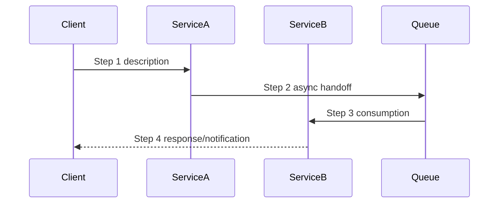

# Flow: {Flow Name}

## Summary

<!-- 1-2 sentence description of this business flow and its business value -->

## Trigger

<!-- What initiates this flow: user action, scheduled job, external event, upstream service call -->

## Sequence

<!-- Ordered steps showing which service/component does what, including async handoffs -->

## Services Involved

| Service | Role in Flow | Key Endpoints/Handlers |
|---------|-------------|----------------------|
| _Example: AppointmentService_ | _Validates and persists booking_ | _POST /api/appointments, AppointmentCreatedHandler_ |

## Data

| Step | Table/Entity | Operation | Owning Context |
|------|-------------|-----------|----------------|
| _1_ | _Appointments_ | _INSERT_ | _Scheduling_ |
| _2_ | _PatientPreferences_ | _READ_ | _Patient_ |

## Events & Queues

| Event | Producer | Consumer | Payload Summary |
|-------|----------|----------|-----------------|
| _appointment.created_ | _AppointmentService_ | _NotificationDispatcher_ | _{ appointmentId, patientId, providerId, scheduledAt }_ |

## Invariants

<!-- System-level invariants this flow relies on. These are assumptions that, if violated, break the flow. -->

- _Example: Patient must have a verified identity before reaching step 3_
- _Example: Provider availability is guaranteed consistent by the Scheduling context's lock mechanism_

## Related Specs

<!-- Links to specs that implemented or modified this flow. Append as the flow evolves. -->

- `specs/{ticket-id}/` — {brief description of what was added/changed}
