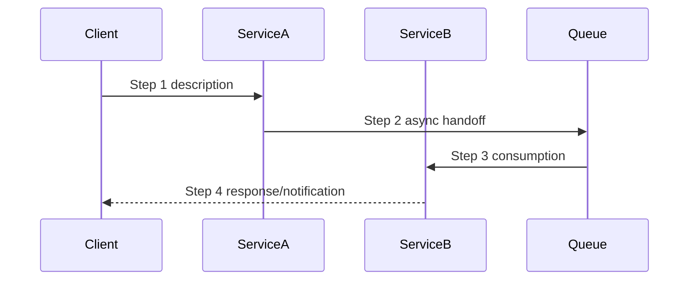

# Flow: {Flow Name}

## Summary

<!-- 1-2 sentence overview of this business flow and the domain value it delivers -->

## Trigger

<!-- What initiates this flow: user interaction, scheduled cron/worker job, inbound domain event, or upstream API call -->

## Sequence

<!-- Ordered interaction steps showing which service/component performs each action, including asynchronous handoffs -->

## Services Involved

| Service | Role in Flow | Key Endpoints/Handlers |
|---------|-------------|----------------------|
| _Example: AppointmentService_ | _Validates and persists booking_ | _POST /api/appointments, AppointmentCreatedHandler_ |

## Data

| Step | Table/Entity | Operation | Owning Context |
|------|-------------|-----------|----------------|
| _1_ | _Appointments_ | _INSERT_ | _Scheduling_ |
| _2_ | _PatientPreferences_ | _READ_ | _Patient_ |

## Events & Queues

| Event | Producer | Consumer | Payload Summary |
|-------|----------|----------|-----------------|
| _appointment.created_ | _AppointmentService_ | _NotificationDispatcher_ | _{ appointmentId, patientId, providerId, scheduledAt }_ |

## Invariants

<!-- System-level and journey invariants this flow depends upon. Violating any of these breaks the business flow. -->

- _Example: Patient must hold a verified identity record prior to reaching step 3_
- _Example: Provider slot availability is guaranteed serialized by the Scheduling context's lock invariant_

## Related Specs

<!-- Links to specifications (in `specs/` or `archive/`) that introduced or modified this flow. Append chronologically as the flow evolves. -->

- `specs/{ticket-id}/` — {concise summary of what was introduced or modified}
